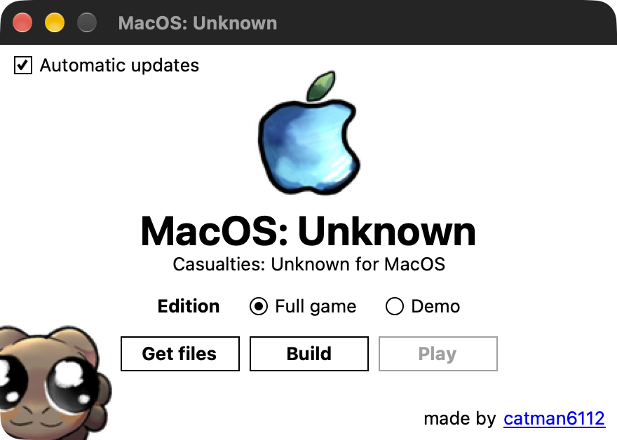

  

<h1 align="center">MacOS: Unknown</h1>
<h3 align="center">Casualties Unknown Porter for Mac :D</h3>

  
  

---

Hey! You! Yeah! You!

Do you like watching cute thing suffer? Well im assuming you do because you play this god-awful gut wrenching game. Well, do i have a deal for you! For the low low price of FREE you can build a copy of the game for your own overpriced red-produce fruit laptop! (macbook) or a desktop. or a monitor. or an ipad running it if you did that for some reason...

## Disclaimers

This project does not contain the source code for Casualties: Unknown. It, however does contain, automated reconstruction of shader assets. It also includes the silly dune picture.  If for whatever reason Orsoniks has an issue with this project, instead of filing a DMCA takedown, i'd much perfer an email sent to [cat@catman6112.dev](mailto:cat@catman6112.dev).

## Installation & Running

Simply look on the right hand side! with your eyes! yeah, you got those, dont ya? See where it says [releases](https://github.com/CatMan6112/macos-unknown/releases/latest)? CLICK THAT. THE GREEN THING. CLICK IT. most recent one, click the thingy where it says latest :o guess what? its the most latest build :tt_proud:

Go ahead and click `MacOS-Unknown-X.X.X.zip` (obviously there will be version nums, not Xs)

Once you have it downloaded, double click the zip file to extract it, and then look at the app.

Wow man that logo is beautiful. i have mad photoshop skillz.

Anyways, open the application, or you can put it in your applications folder if you want.

10/10 chance it'll say "o-oh~!! m-master.. t-the f..file~!! i-it's too... d-dangerous~!!" click done. go to your settings, go to **privacy and security**, scroll to the bottom, you should see something to let you allow it.

Now, click **"Get Files"** Ensure your steam client is connected and opened. Click your version first, obviously :3

  

Now, a scarryyyy warning will pop up. read it, all is well with the world do not fear. Now a super scary terminal will pop up, just do <kbd>command</kbd> <kbd>V</kbd>. "Well, cat," you might be asking yourself. "I learned not to paste random commands into my steam console!" Fear not, for you can simply *read* the command.

Mhm, mhm, yes I see. `download_depot`. You will *never* guess what it does. It downloads a game *from* the depot!! home depot? no.. i dont think. Basically, macos steam doesnt like windows. therefore will only download macos apps and their files. C:MacOS needs windows files to convert into metal-native files. So, we have to point a gun to daddy Gabe's head and ask him to kindly download the game's files reguardless of what the OS is.

Once that is downloaded, simply click **build**.

Now, while the app is building, you will notice your CPU is kind of being.. consumed. Fear not, simply open netflix in your browser, pray you have a macbook pro for the fans, or simply wait for it to run. 9/10 modern macbooks are efficient enough to do this (specifically the Air and Neo) models without overheating, although you may want to turn off other apps in the background if you cant have sufficient cooling.

Now, after it has finished building the port, you will NEVER guess what you click to play the game. that's right. **PLAY!!!**

## Congratulations!

  

I am me! 
I want to be myself! 
I want to continue existing in this world! I am worth living here! Congratulations! Congratulations! Congratulations! Congratulations! Congratulations! Congratulations! Congratulations! Congratulations! Congratulations! Congratulations! Congratulations! Congratulations! Congratulations!

Evangelion references out of the way, congratulations. You now have hopefully succesfully built a functioning port of the first full release of C:U for macos. Click play, enjoy yourself, go feel bad for failing your little expie and or dune and or milky.

## Issues & Contributions

Do you see an issue? Do you not know programming to make a PR and fix it? That's A-OK! Simply go to the tab that says ["Issues"](https://github.com/CatMan6112/macos-unknown/issues) on the github page, and select ["New Issue"](https://github.com/CatMan6112/macos-unknown/issues/new) in it, describe the issues you are experiencing and submit it. I will reply whenever I get the time and will probably work on it.. whenever I get the time. I am a full-time student yknow.

Contributions are more than welcome! Do you spot an area in the code that could be more efficient? Maybe wanna add your own silly messages in the code comments for no apparent reason? [MAKE A PULL REQUEST](https://github.com/CatMan6112/macos-unknown/pulls) I DONT HAVE ANYTHING BETTER TO DO!!!!

## More disclaimers

This project was AI-Assisted. Notice how i said Assisted and not vibecoded? Thats because I also put in effort and closley monitored what claude was doing. I dont wanna hear a single person "shame" me for using an AI to do literally the most boring and mundane tasks of porting. This includes handwriting scripts to port shader code so water isnt a grey fucking block, and also yknow making the game not run at 12fps because macos is built by somehow people making more money a year than me yet you have to jump through 10 kinds of fucking loops to turn off rendering at a pro-retina display level. GOD. *ahem*. Ai was used ethically during this projects creation, all visual assets, \*most of the code, and, of course, the soul of the project, was made by a real human being with ambitions, goals, and a beating heart. Or maybe it wasnt. thats right. im chatgpt. :peace: (anyways all jokes aside, LLMs being useful and doing the painful and annoying tasks of porting a game to use on another platform was the reason this project was able to be created less than 24 hrs after the public release of Casualties Unknown) Thank you for taking the time to read this.

I love you oro
